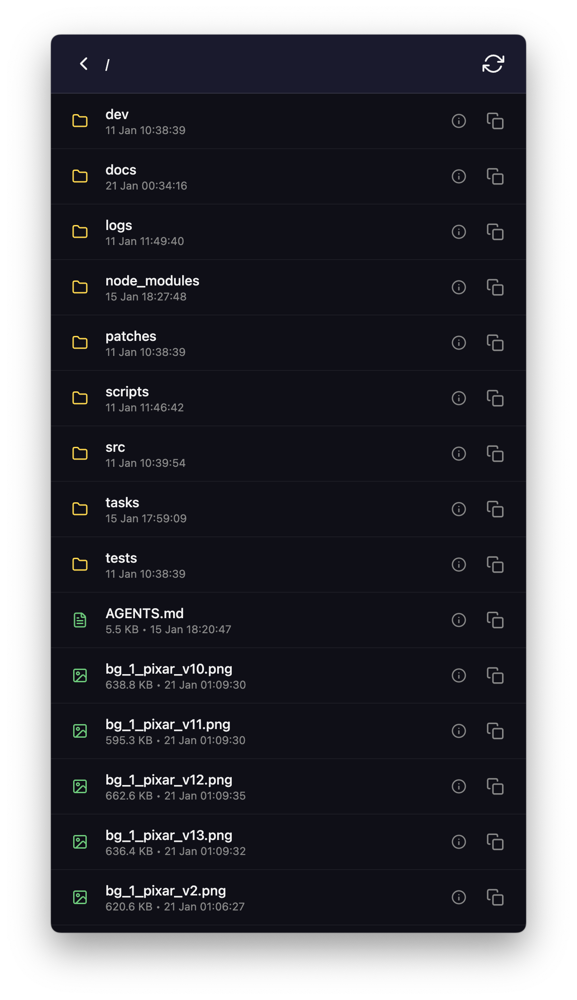
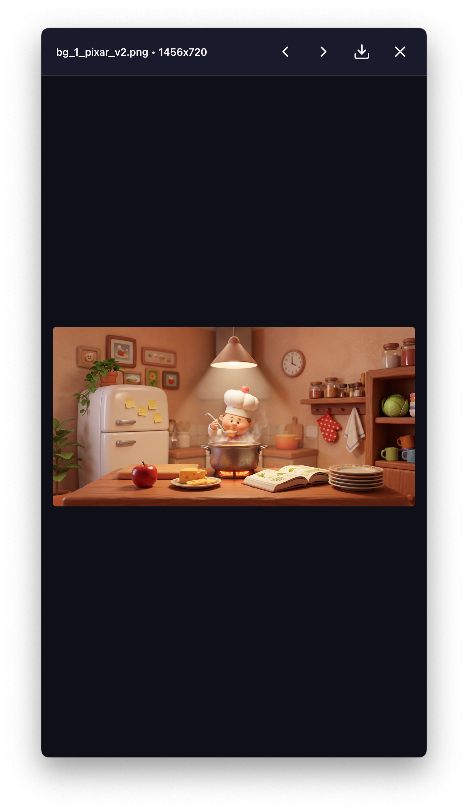
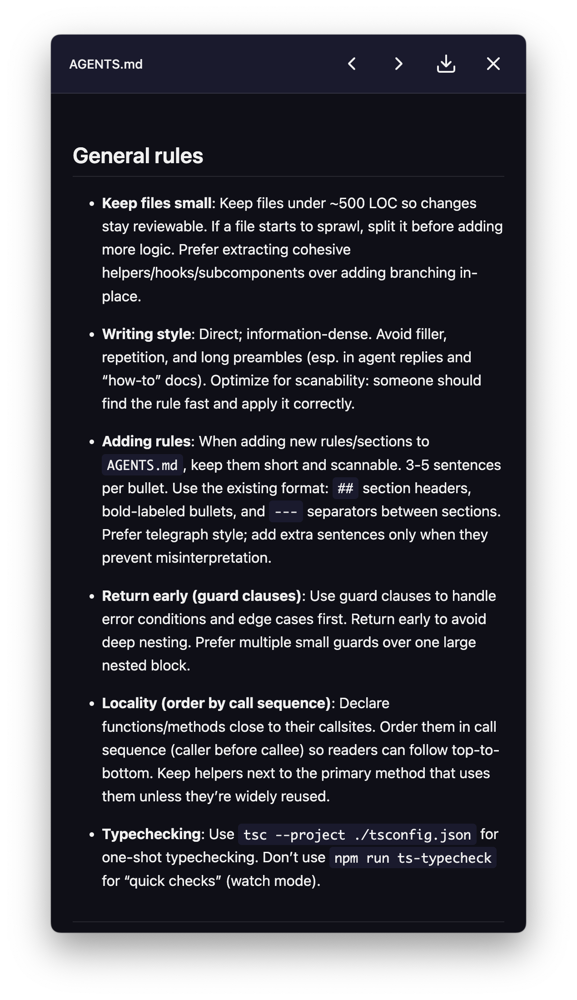

# Browsey

A mobile-friendly web file browser CLI tool built with Bun.

Start a local web server to browse files from any device on your network - perfect for quickly accessing files on your computer from your phone or tablet.

<div>
  
  
  
</div>

## Features

- **Mobile-first UI** - Touch-friendly interface with large tap targets
- **Dark theme** - Easy on the eyes
- **Copy path** - One-tap copy of absolute file paths
- **Ignore patterns** - Filter out files/folders with glob patterns
- **QR code** - Scan to open on mobile instantly
- **Bonjour discovery** - API advertises itself on local network (`_browsey._tcp`)
- **Zero config** - Just run `browsey` and go

## PWA Install

Browsey is installable as a PWA when served over HTTPS (or localhost). If you want Add to Home Screen on a remote device, put Browsey behind a TLS-terminating reverse proxy.

## Quick Start

Run directly with `bunx` — no installation needed:

```bash
bunx browsey start .
```

Or install globally:

```bash
bun install -g browsey
browsey start .
```

## Usage

```bash
# Serve current directory
browsey start

# Serve a specific directory
browsey start ./photos

# Custom ports
browsey start -p 3000 --app-port 3001

# Open browser automatically
browsey start --open

# Allow file modifications (default is read-only)
browsey start --no-readonly

# Ignore patterns
browsey start -i "node_modules,.git,*.log"

# Show hidden files
browsey start --hidden

# All options
browsey start ./my-folder -p 4200 --app-port 4201 -i "node_modules,.git" --hidden --open --no-readonly --no-qr
```

All commands work with `bunx browsey` too:

```bash
bunx browsey start ./photos --open
```

## Options

| Option | Description | Default |
|--------|-------------|---------|
| `[path]` | Directory to serve | `.` (current) |
| `-p, --port <port>` | Port number | `4200` |
| `-h, --host <host>` | Host to bind | `0.0.0.0` |
| `-i, --ignore <globs>` | Comma-separated ignore patterns | - |
| `--open` | Open browser automatically | `false` |
| `--no-readonly` | Allow file modifications | `false` |
| `--hidden` | Show hidden files | `false` |
| `--no-qr` | Do not display QR code | `false` |
| `--no-bonjour` | Disable Bonjour/mDNS API advertisement | `false` |
| `--no-https` | Disable HTTPS | - |
| `--https-cert <path>` | Path to TLS certificate (PEM) | `./certs/browsey.pem` |
| `--https-key <path>` | Path to TLS private key (PEM) | `./certs/browsey-key.pem` |
| `--no-agents` | Disable the agent thread launch endpoints | `false` (agents on) |
| `--agents-token <token>` | Use this agent token instead of the persisted one | - |
| `--access-token` | Require `X-Browsey-Access-Token`, read from `~/.browsey/access-token` | `false` (unprotected) |
| `--access-token-file <path>` | Require `X-Browsey-Access-Token`, read from this file | - |

## API

Browsey exposes a simple REST API:

| Endpoint | Description |
|----------|-------------|
| `GET /api/health` | Health, readonly mode, host metadata and persistent `serverId` |
| `GET /api/list?path=/` | List directory contents |
| `GET /api/sync/manifest?path=/&revision=<sha256>` | Recursively snapshot a tree for offline sync; matching revisions return `unchanged: true` |
| `GET /api/file?path=/file.txt` | Download a file |
| `GET /api/view?path=/file.txt` | View text, images, and supported videos |
| `GET /api/stat?path=/file.txt` | Get file metadata |
| `GET /api/search?path=/&q=term` | Filename search by default, or text search with `mode=content`; optional `hidden=1`, `limit`, `progressive=1` |
| `POST /api/save` | Save an existing text file; requires read-write mode and `baseModified`/`baseSize` conflict guards |
| `GET /api/git/changes?path=/` | Git file changes |
| `GET /api/git/commit?path=/&hash=<sha>` | Git commit details, stats, navigation, and changed files (`includeAdjacent=0` skips navigation lookup) |
| `POST /api/git/revert` | Discard changes for one git file |
| `GET /api/agents?path=/` | Agent capabilities: installed CLIs, model lists and live sessions; `path` adds the working directory a launch would resolve to (**bearer token required**) |
| `POST /api/agents/models/refresh` | Refresh Claude and Codex catalogues independently; returns capabilities plus each agent's `refresh` status (`refreshed`, `failed` with an error, or `unavailable`) (**bearer token required**) |
| `GET /api/agents/skills?agent=claude-code&path=/` | Skills the agent would see for a launch at `path`: its global ones plus the project's, from the folder up to the git root (**bearer token required**) |
| `POST /api/agents/launch` | Start a Codex thread, or open a Claude session (**bearer token required**) |
| `POST /api/agents/trust` | Trust the resolved launch folder for agents that require it (**bearer token required**) |
| `GET /api/agents/launch/events?id=&since=` | Reattach to a launch whose stream dropped; replays every event after `since`, then follows it live (**bearer token required**) |
| `POST /api/agents/stop` | End a live Claude session (**bearer token required**) |

When the server runs with an [access token](#access-token), *every* row above additionally
requires an `X-Browsey-Access-Token` header — health included.

The API resolves a symlinked server root to its physical directory for file and Git paths.
Git changes return a repository path relative to that root, so changed files remain openable
when the server starts through a symlink such as `~/dev`.

Search ranks exact names, then prefixes, substrings, and fuzzy matches. A completed response adds
`status: "complete"`, `hasMore`, and `nextCursor` to the existing `query` and `results` fields.
Pass the returned `jobId` and `cursor=<nextCursor>` to fetch more results. For a large tree,
`progressive=1` returns `status: "searching"` immediately; poll with `jobId` for early filename
matches and the completed ranking. Early matches are provisional until the status is complete.
`DELETE /api/search?jobId=<id>` cancels a superseded search. Existing clients that omit
`progressive=1` wait for the complete first page. Hidden files remain excluded unless the server
was started with `--hidden` or the request sets `hidden=1`; configured ignore patterns always apply.
Directory symlinks are returned as matches but are not traversed.

Set `mode=content` for a case-insensitive literal search inside regular UTF-8 files. Each matching
file appears once with its first match's `contentMatch: { line, snippet }`; directories and symlinks
are not content results. Files larger than 1 MiB, binary or invalid UTF-8 files, and unreadable files
are skipped; responses report `skippedLargeFiles`, `skippedBinaryFiles`, and `skippedUnreadableFiles`.
Content jobs use the same progressive polling, stable completed pagination, scope, hidden, ignore,
and cancellation behavior as filename jobs. The `mode` response field lets new clients detect an
older server; omitting `mode` retains the original filename behavior.

### Server identity

`/api/health` and Bonjour TXT expose the same public `serverId`. It identifies
one canonical root-directory/port configuration in this Browsey installation,
not one IP address or process. Different network interfaces and process restarts
keep the ID; a different root or port gets another ID. Names are not identifiers.

Immutable identity records live in `~/.browsey/server-identities/`. Keep this
directory when upgrading; copying it to another computer would also copy those
identities. Concurrent initial starts publish one record atomically. Corrupt
records fail explicitly rather than silently replacing IDs. The field is an
additive API extension and not an authentication credential; agent tokens must
not be inferred or transferred based on a matching public ID.

### Response format

`GET /api/list?path=/`

```json
{
  "path": "/",
  "items": [
    {
      "name": "documents",
      "type": "directory",
      "size": 4096,
      "modified": "2024-01-15T10:30:00.000Z",
      "extension": null
    },
    {
      "name": "photo.jpg",
      "type": "file",
      "size": 245678,
      "modified": "2024-01-14T08:20:00.000Z",
      "extension": "jpg"
    }
  ]
}
```

## Access token

Browsey is **unprotected by default**: anything that can reach the port can use the API.
That is the right trade for a LAN, and it is why nothing below changes unless you ask for
it. Turn the access token on when the API is reachable from anywhere else — published
through a Cloudflare Tunnel, say, where this is the origin's own second line of defence
behind whatever guards the edge.

```bash
browsey start --access-token                      # mints ~/.browsey/access-token (0600)
browsey start --access-token-file /etc/browsey.tk # or read one you manage yourself
BROWSEY_ACCESS_TOKEN=… browsey start              # or from the environment (launchd, systemd)
```

- **Never as a flag value.** There is no `--access-token <value>`: a process list is
  readable by every user on the machine and shell history keeps it forever. The token comes
  from the environment, from a file, or from the default file — nothing else.
- **Resolution order**: `BROWSEY_ACCESS_TOKEN`, then `--access-token-file <path>`, then
  `--access-token` (the default file, minted on first use like the agent token). If none of
  them resolve, protection stays off.
- **What it covers**: every path under `/api/`, checked before routing — `/api/health`, the
  live-reload SSE stream, media, mutations, Git and the agent routes alike. `OPTIONS` is
  exempt so CORS preflight still works.
- **The header** is `X-Browsey-Access-Token`, exact case. Never a query parameter: those end
  up in proxy logs and browser history. The comparison is constant-time.
- **Rejections** are `401` with `{"error": "Browsey access token required"}` when the header
  is missing and `{"error": "Invalid Browsey access token"}` when it is wrong. The received
  value is never echoed back or logged.
- **Separate from the agent token.** `Authorization: Bearer <agent-token>` keeps its current
  meaning on `/api/agents/*` only. A protected server requires **both** there: the access
  token first, then the bearer.
- **`browsey api reload`** re-resolves the token from the environment or the default file.
  The instance registry records only *that* protection was on, never the value.

### The bundled web UI does not send it

The browser UI (`browsey app`, `browsey start`) has no way to learn the token, and Browsey
deliberately does not inject one into the served HTML — that would hand it to every browser
on the LAN. **A protected server is an API-only, mobile-app setup.** If you want the web UI,
run without the access token and keep the server on the LAN.

## Pairing a remote origin

`browsey pair` prints a JSON QR payload — JSON rather than a URL, so a stray scan by a stock
camera app cannot turn the secrets into an HTTP request. Payloads stay at `v: 1` unless
there is something remote to carry, so older clients keep pairing exactly as before.

```bash
browsey pair                                          # v1: agent token + LAN URL
browsey pair --url https://browsey.example.com \
             --access-token \
             --cf-credentials-file ~/.cloudflared/browsey-service-token.json
```

```jsonc
{
  "v": 2,
  "kind": "browsey-pair",
  "url": "https://browsey.example.com",
  "name": "Studio",
  "token": "<agent token>",                                  // optional
  "access": "<access token>",                                // optional
  "cf": { "id": "<client id>", "secret": "<client secret>" }  // optional
}
```

- **Cloudflare Access credentials** come from `CF_ACCESS_CLIENT_ID` + `CF_ACCESS_CLIENT_SECRET`
  or from `--cf-credentials-file <path>`, a JSON file `{"id": "…", "secret": "…"}`. Both
  halves are required; never as flag values.
- **HTTPS is mandatory** for `access` and `cf`. Pairing a plain-HTTP URL with either of them
  is refused outright — pass `--url https://<your tunnel hostname>`.
- **Protection is detected**, not assumed: if the running instance requires an access token,
  `pair` includes it without being asked. `--access-token` / `--access-token-file` force it.
- Agent-only and remote-only pairing are both legal. The QR carries whichever of the two
  credentials actually resolved.

## Agent threads

Browsey can put an agent to work on this machine from a paired mobile app. The two agents
behave differently, because the apps you pick the work up in do.

- **[Codex](https://developers.openai.com/codex/cli)** takes a prompt together with the
  folder, file or excerpt you launched from, runs it, and is forgotten. Browsey answers as
  soon as the thread exists; the result is waiting for you in the Codex app, or under
  `codex resume`.
- **[Claude Code](https://docs.claude.com/en/docs/claude-code)** opens a live Remote Control
  session in a directory and answers with a link that opens *that* session in the Claude
  phone app, which is where the conversation then happens. The prompt is optional: given
  one, the session starts on it immediately; left blank, it opens idle and waits for you to
  say something. Either way the session stays up until you stop it, and survives a browsey
  restart.

Agent endpoints are **enabled by default** and always require a bearer token.

```bash
browsey pair              # print the token and a pairing QR code
browsey start --no-agents # or turn the endpoints off entirely
```

- **Token**: generated once, stored at `~/.browsey/agent-token` with mode `0600`, reused
  across restarts. `--agents-token` overrides it for one run without persisting.
- **Not gated by `readonly`**: `--no-readonly` protects Browsey's *own* file mutations.
  Agents have their own opt-in (`--no-agents`) plus the token, so the two are independent.
- **Full access**: Claude sessions run with `--permission-mode bypassPermissions`; Codex is
  driven over the app-server protocol with `sandbox: danger-full-access` and
  `approvalPolicy: never` — equivalent to `--dangerously-bypass-approvals-and-sandbox`, and
  recorded in a way the Codex apps list. Anyone holding the token can run arbitrary code on
  the machine — treat it like an SSH key.
- **cwd**: resolved to the nearest agent project already known to the CLI, else the git
  root, else the target folder — so threads land in real projects and reuse their history.
- **Models**: `GET /api/agents` serves cached model lists from the signed-in Codex and
  Claude catalogues, with a small fallback while they load. **Refresh models** in the
  mobile app requests both catalogues, including newly released Codex models. A failure
  in one catalogue still returns the other agent's updated list and both refresh statuses.
- **Workspace trust**: Claude Code may refuse a new workspace before Remote Control can
  register. Browsey detects that prompt and reports the folder as untrusted immediately;
  it never accepts the security prompt on launch. The mobile app then offers an explicit
  **Trust Folder** action (`POST /api/agents/trust`), after which you launch again. The
  server changes only the resolved cwd's `hasTrustDialogAccepted` flag in `~/.claude.json`,
  first preserving the original as `~/.claude.json.browsey-backup`, then replacing the live
  config atomically.
- **Titles**: a thread is named by a small model reading the prompt you sent it, so the list
  in either app reads like a list of tasks rather than one repeated folder name. Codex is
  named a moment after it starts, so the launch does not wait. A Claude session has to be
  named before it starts — a Remote Control session's name is fixed for its lifetime — which
  is why a Claude launch takes a handful of seconds longer than a Codex one. If that
  generation fails or takes too long, the title falls back to the opening of your prompt;
  launch with no prompt at all and the name is the folder.
- **Live sessions**: `GET /api/agents` lists the Claude ones, read from Claude's own state
  directory and filtered by whether the process is still alive — so a session started before
  the last browsey restart is still listed and still stoppable. `POST /api/agents/stop` ends
  one by `sessionId`.
- **Logs**: stdout/stderr of each run goes to `~/.browsey/agent-runs/<timestamp>-<agent>.log`
  (debugging only, no rotation yet).
- **Failures**: a Codex launch answers before the run finishes, so if that thread dies
  afterwards the reason is remembered and reported as `lastFailure` on the next
  `GET /api/agents` — which is how the app can tell you "your login expired" instead of
  silently producing threads that never ran. A Claude session is different: it either
  registers within a second or the launch fails outright.
- **Binary resolution**: `BROWSEY_CLAUDE_BIN` / `BROWSEY_CODEX_BIN`, then `~/.local/bin/claude`
  and `/opt/homebrew/bin/codex`, then `PATH` (augmented with those two directories, which
  matters for the launchd-managed instance). Claude additionally needs a controlling
  terminal, which comes from `script(1)` — no native pty module is involved.

## Development

```bash
# Clone the repo
git clone https://github.com/vforsh/browsey.git
cd browsey

# Install dependencies
bun install

# Run in dev mode
bun run dev

# Build
bun run build

# Link locally for testing
bun link
```

## Tech Stack

- **Bun** - Runtime, bundler, and package manager
- **TypeScript** - Type safety
- **Bun.serve** - Native HTTP server
- **Bun.Glob** - Pattern matching
- **Commander.js** - CLI argument parsing
